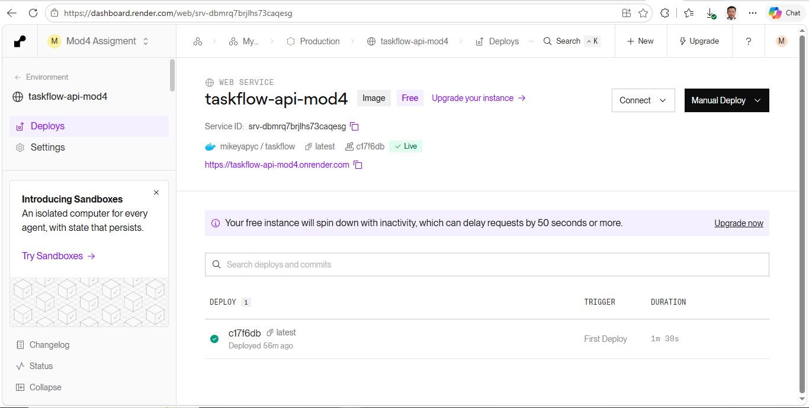
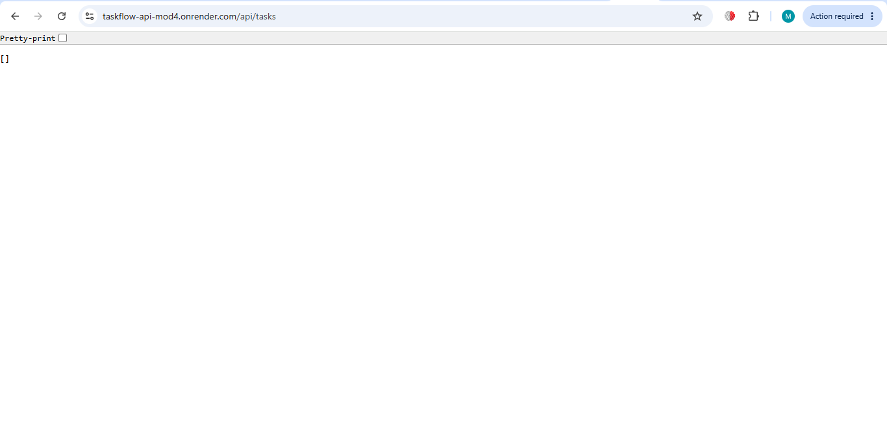

# taskflow-api-mod4

Spring Boot 4 REST API for managing tasks (NTU AI Module 3/4 project).
In-memory task store with `GET`/`POST` endpoints.

## Live deployment

- **Platform:** Render (Web Service, free tier)
- **URL:** https://taskflow-api-mod4.onrender.com
- **Image:** `mikeyapyc/taskflow:latest` on Docker Hub

| | |
|---|---|
| `GET /api/tasks` | List all tasks |
| `POST /api/tasks` | Create a task `{"title":"...", "completed":false}` |

> Free Render instances sleep after ~15 min idle — the first request after a
> pause can take ~60 s while it cold-starts.

### Deployment screenshots

Render dashboard showing the service **Live**:



Live `GET /api/tasks` response from the deployed service:



## Local run

```bash
mvn spring-boot:run
# or: mvn package && java -jar target/*.jar
```

## Build & test

```bash
mvn clean verify
```

## Docker

```bash
docker build -t taskflow .
docker run -p 8080:8080 taskflow
```

## Stretch goals (optional)

### Option 1: CI pipeline (GitHub Actions)

A GitHub Actions workflow (`.github/workflows/ci.yml`) runs on every push to
`main`: builds the project, runs the tests (`mvn clean verify`), then builds the
Docker image and pushes it to Docker Hub as both `mikeyapyc/taskflow:latest`
and a commit-SHA tag. Docker Hub credentials are stored as repository
**secrets** (`DOCKERHUB_USERNAME`, `DOCKERHUB_TOKEN`) — never in code.

- Workflow: https://github.com/Mikey-ai3355/taskflow-api-mod4/actions/workflows/ci.yml
- Image on Docker Hub: https://hub.docker.com/r/mikeyapyc/taskflow
- Successful run: <LINK TO A GREEN RUN>

This gives two pipelines side by side: CI publishing to Docker Hub, and the
Render web service deploying from that image.

### Option 2: Frontend on Netlify

A static frontend (`frontend/`) lists the tasks, adds new ones, and
toggles/deletes them by calling the deployed API. It is deployed to Netlify.

- Netlify URL: <YOUR-NETLIFY-URL>
- The browser blocks cross-origin requests from the Netlify domain, so the API
  enables CORS for `/api/**` in
  `src/main/java/sg/edu/ntu/taskflow_api/config/CorsConfig.java`.
  For this assignment all origins are allowed; in production restrict it to the
  Netlify site.
- Screenshot of the frontend showing data from the API: `screenshots/frontend.png`
